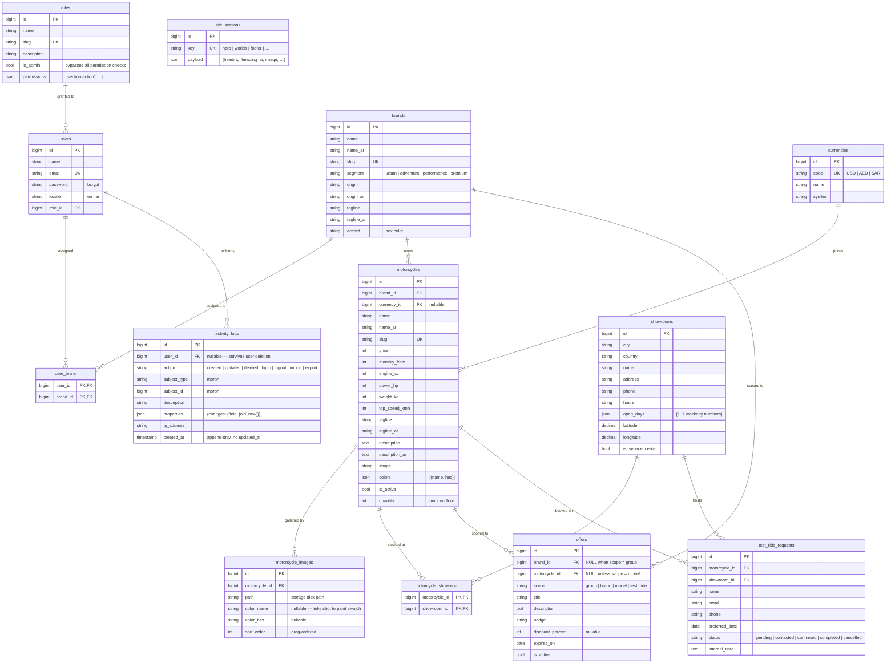

# VANTA MOTO — Database ERD

## Diagram



## Design decisions

| Decision | Reason |
|---|---|
| `roles` + `permissions` JSON | Custom RBAC — admins compose roles from a per-module action matrix without code changes. `is_admin` short-circuits every check; the last admin role can't be demoted or deleted. |
| `user_brand` composite PK pivot | Brand restriction is the second authorization axis — a proper join table keeps it queryable (`whereIn`) and prevents duplicate assignments. |
| `motorcycle_images` per-image colour fields | `color_name`/`color_hex` on the *image* (not the model) is what lets the public site swap the displayed shot when a paint swatch is picked. `sort_order` powers drag-ordering in the CMS. |
| `motorcycle_showroom` pivot | Stock is per showroom — test-ride booking validates the chosen model actually exists at the chosen showroom. |
| `showrooms.open_days` JSON | Weekdays the floor accepts test rides — the booking API rejects dates on closed days, and the public form blocks them upfront. |
| `offers.scope` + nullable FKs | One table models group-wide, brand, model and test-ride promotions without polymorphism — `scope` says which FK is meaningful. |
| `site_sections` key/payload | CMS-editable public copy without a schema per page — `SiteContent` registry defines the keys and their field shapes. |
| `activity_logs` morphs + `properties` | One audit table for every model; the diff payload (`{field: [old, new]}`) makes updates reviewable. Append-only — no `updated_at`, no deletes. |
| `currencies` | Real money data needs a code+symbol entity, not hardcoded strings; `nullOnDelete` keeps prices intact if a currency is removed. |
| `test_ride_requests` never deleted | Customer submissions are business records; staff may update `status`/`internal_note` only — the policy deliberately has no `delete`. |
| Indexes | `brand_id`, `status`, `status+created_at`, `country+city`, `action`, `subject`, `motorcycle_id+sort_order` — covering the exact list/filter queries the CMS runs. |
| `cascadeOnDelete` on children | Deleting a brand removes its motorcycles/assignments; controller guards block destructive deletes when dependents still exist. |

## Access model

```
role.is_admin          → every permission granted, brand scoping skipped
role.permissions       → 'section.action' strings checked by perm: middleware
                         + policies; sidebar hides unreachable sections
user_brand             → non-admin roles only see/manage their brands' content

Motorcycle/Offer CRUD   → policy checks entity.brand_id ∈ user's brands
TestRideRequest update  → policy checks motorcycle.brand_id (via relation)
Admin-only sections     → reports, activity log, currencies, roles, staff,
                          site content (default registry — configurable per role)
```
