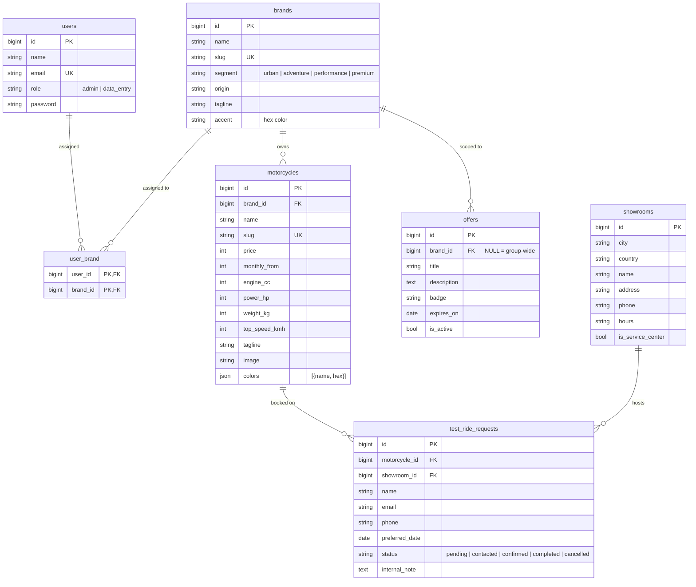

# VANTA MOTO — Database ERD

## Diagram



## Design decisions

| Decision | Reason |
|---|---|
| `user_brand` composite PK pivot | Brand restriction is the core authorization rule — a proper join table keeps it queryable (`whereIn`) and prevents duplicate assignments. |
| `offers.brand_id` NULL-able | A `NULL` FK means "group-wide offer" — no sentinel row or extra table needed. Only admins may create these (enforced in `OfferRequest` + `OfferPolicy`). |
| `motorcycles.colors` JSON | Paint options are presentational attributes of a model, not entities users reference — a JSON column avoids a join table nobody would query. |
| `test_ride_requests` never deleted | Customer submissions are business records; staff may update `status`/`internal_note` only — the policy deliberately has no `delete`. |
| Indexes | `brand_id`, `status`, `status+created_at`, `country+city` — covering the exact list/filter queries the CMS runs. |
| `cascadeOnDelete` on FK children | Deleting a brand removes its motorcycles/assignments; guard clauses in controllers block destructive deletes when dependents exist. |

## Access model

```
admin       → canAccessBrand(any id) = true
data_entry  → canAccessBrand(id) = id ∈ user_brand

Motorcycle/Offer CRUD   → policy checks entity.brand_id
TestRideRequest update  → policy checks motorcycle.brand_id (via relation)
Showrooms / Brands / Users → `admin` middleware (group-level facilities)
```
